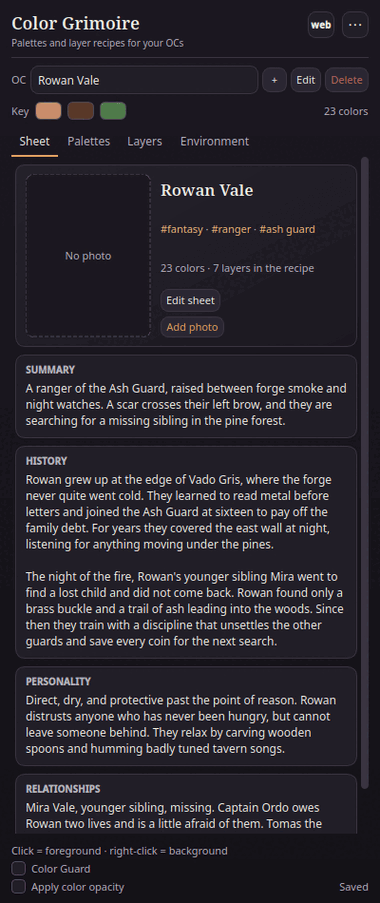
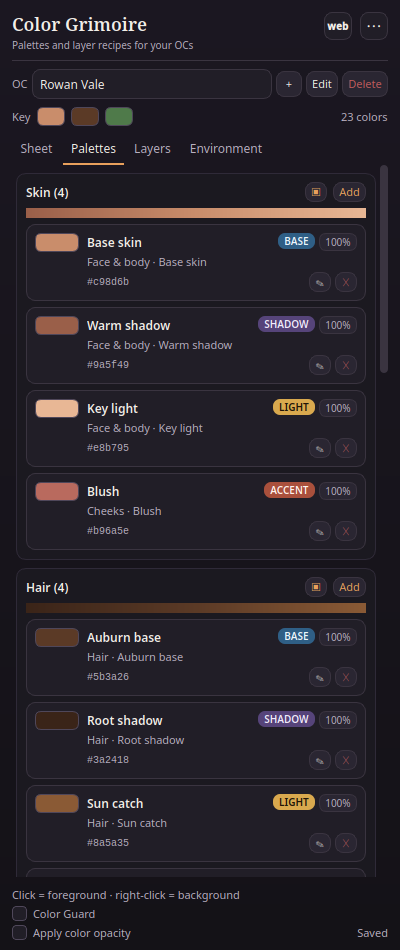
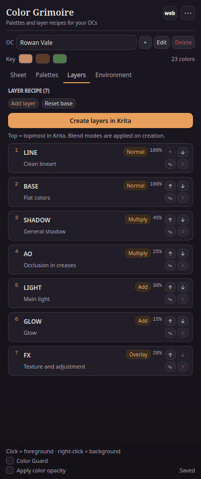
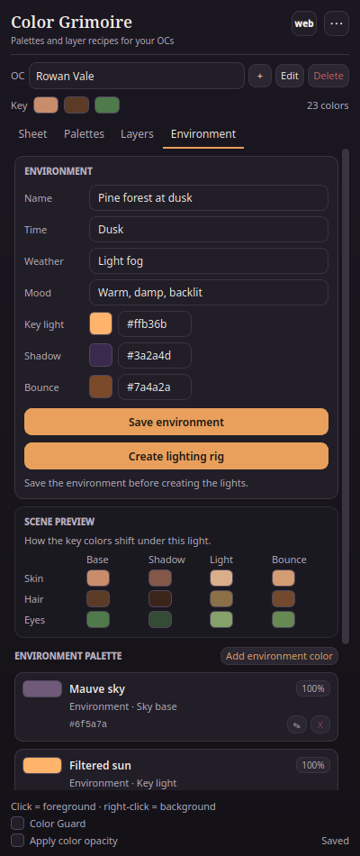
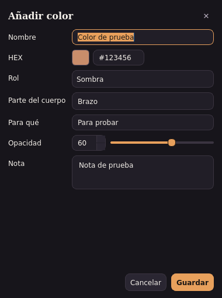
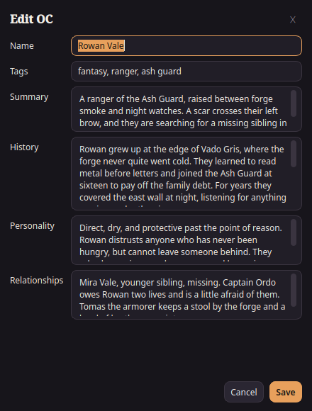

# Color Grimoire

A Krita docker for keeping your OCs' colors, body-part notes, layer recipes and environment palettes in one place.



Color Grimoire is the missing character sheet inside Krita: pick an OC, see every color with its purpose and body part, click a swatch to set the foreground color, and create the layer stack with the right blend modes in one action.

## Features

- **OC sheets**: name, three-line summary, history, personality, relationships and tags.
- **Optional OC photo**: add, change or remove a reference photo; it is copied to the local `images/` folder and shown in the sheet hero.
- **Optional zone examples**: add a painted crop per zone (hair base/shadow, skin, etc.) with the `▣` button.
- **Color ramps**: each zone shows an automatic shadow → base → light gradient.
- **Eight palette zones**: skin, hair, eyes, clothing, armor, accessories, private and marks/scars.
- **Useful swatches**: name, HEX, role (base/shadow/light/accent/detail), body part, purpose, opacity and a free note.
- **One-click color**: left click = foreground, right click = background; optional swatch alpha.
- **Layer recipe**: order, blend mode (Multiply, Add, Screen, Overlay, Soft Light, Color Dodge, Burn, Linear Burn…), opacity and purpose.
- **Create layers in Krita**: builds a group with the recipe, its blend modes and opacities in the active document.
- **Environment**: scene name, time, weather, mood, key light, shadow tint, bounce and an environment palette.
- **Scene preview**: the key skin, hair and eye colors tinted by the scene's key light, shadow and bounce; click a chip to use it.
- **Create lighting rig**: a group of fill layers with SHADOW (Multiply), AO (Multiply), LIGHT (Add), GLOW (Add) and BOUNCE (Add), using the environment colors and the recipe opacities. The group inherits alpha to clip to the layers below.
- **Color Guard**: compares the current foreground color with the active OC's palette, shows the nearest swatch and ΔE, and offers **Snap** to correct it.
- **Private zone**: hidden by default with a “Show private” toggle. The data is local; it is not encrypted.
- **JSON + `.gpl`**: export/import the whole library and export a GIMP palette for Krita's Palette Docker.
- **Spanish / English UI**: follows the system language; switch any time in `⋯ → Language`.
- **Custom translations**: add your own JSON language files in `translations/`; the menu creates a template, opens the folder and reloads them.
- **Web companion button**: open the web Grimoire in your default browser; configure a local `index.html` path or a hosted URL.
- **Local and offline**: no accounts, no network, no telemetry.

## Install

### Recommended: ZIP via Krita

1. Download `grimorio_color-0.4.1.zip` from the Releases page.
2. In Krita: **Tools → Scripts → Import Python Plugins**, select the ZIP.
3. Restart Krita.
4. **Settings → Configure Krita → Python Plugin Manager**: enable **Color Grimoire**.
5. Restart Krita again.
6. Open the panel from **Settings → Dockers → Color Grimoire**.

The ZIP contains `grimorio_color.desktop` at the root and the `grimorio_color/` folder next to it. Krita discovers plugins with `pykrita/*desktop`; both files must land in Krita's `pykrita` folder.

### Linux manual install

```bash
bash install.sh
```

The script detects the Flatpak (`~/.var/app/org.kde.krita/data/krita/pykrita`) and native (`~/.local/share/krita/pykrita`) paths, copies the plugin and prints the activation steps. The ZIP method works on Windows, macOS and Linux; the script is only a Linux convenience.

## Screenshots

| Palettes | Layers | Environment |
| --- | --- | --- |
|  |  |  |

| Color dialog | OC dialog |
| --- | --- |
|  |  |

## How it works

The docker stores everything in a single JSON file. It is the source of truth; the `.gpl` export is only for Krita's palette docker. Use `⋯ → Export JSON…` for backups and `⋯ → Import JSON…` to restore or move the library to another machine.

### Data paths

- **Linux Flatpak**: `~/.var/app/org.kde.krita/data/krita/grimorio-color/grimorio.json`
- **Linux native**: `~/.local/share/krita/grimorio-color/grimorio.json`
- **Windows**: `%APPDATA%\krita\grimorio-color\grimorio.json`
- **macOS**: `~/Library/Application Support/krita/grimorio-color/grimorio.json`

`⋯ → Open data folder` opens the folder for you.

The reference photos and zone examples are copied to the `images/` folder next to the JSON. Back up the JSON **and** the `images/` folder together; importing a JSON on another machine without the folder shows the placeholders. The `translations/` folder holds your custom language files; it is also local.

### Custom translations

1. Open `⋯ → Language → Create translation template`.
2. Copy `translation-template.json` to `<code>.json`, for example `fr.json`.
3. Set `code` and `name`; translate the values in `strings`. The keys are the Spanish source strings; empty or missing values fall back to Spanish.
4. Use `⋯ → Language → Reload translations` (or restart Krita).

The template includes every translatable string. The plugin creates `translations/README.txt` with the same steps.

The plugin also loads **bundled translations** from `grimorio_color/translations/*.json` (the community folder in the repository). Your files in the user `translations/` folder override the bundled ones. To contribute a language, copy the template to `<code>.json`, fill the values and open a pull request; see [CONTRIBUTING.md](CONTRIBUTING.md) and `grimorio_color/translations/README.md`.

### Web companion

The `web` button in the header (and `⋯ → Open web Grimoire`) opens the web app in your default browser. The default target is `~/proyectos/grimorio-color/index.html`; use `⋯ → Set web Grimoire…` to change it to any local path, an `http(s)://` URL or a `file://` URL.

The web app is **not bundled** in the plugin ZIP and uses its own `localStorage`; it does not sync automatically with the plugin. Move data with **Export JSON** in the plugin and **Import JSON** in the web app (and the reverse). The web app preserves `referenceImage` and `zoneExamples` in JSON round-trips.

## Privacy

No network access, no accounts, no telemetry. The plugin only reads and writes the local JSON and the files you choose in the export dialogs. The Private zone is hidden in the UI but stored in the same JSON; back it up accordingly.

## Compatibility

| Krita | Qt | Status |
| --- | --- | --- |
| 5.3.4.1 | Qt 5 / PyQt5 | Supported; model, bridge, translation and UI tests pass. Full real re-run pending (Krita open locks the resource database). |
| 6.0.4.1 | Qt 6 / PyQt6 | Full real test: layer stack, all blend IDs and the lighting rig. The 0.3.0 UI/entry is tested with the real Krita API. |

The plugin is pure Python and ships no binaries. Windows and macOS use the same ZIP and the same JSON format, but they have not been tested yet. If you try them, please open an issue with the Krita version and the error from the Python Plugin Manager.

## Development

The runtime is a PyKrita docker with a pure-Python model. Tests:

```bash
# Pure model (no Krita, no Qt)
python3 -m unittest test_model.py -v

# UI offscreen with PyQt5 (Krita 5.3 Flatpak Python) or PyQt6
flatpak run --command=python3 org.kde.krita test_ui_offscreen.py

# Bridge and plugin entry point with a fake Krita
flatpak run --command=python3 org.kde.krita test_bridge.py

# Real Krita API (run inside Krita with kritarunner)
flatpak run --env=QT_QPA_PLATFORM=offscreen --env=QT_QPA_PLATFORMTHEME= \
  --env=PYTHONPATH="$PWD" --command=kritarunner org.kde.krita \
  --script test_krita_real -f main
```

The real API test runs on Krita 6.0.4.1 and verifies the layer group order, all blend-mode IDs, the opacities and the lighting rig. The same API calls are covered by the Krita 5.3 PyQt5 model/UI tests. The UI tests render screenshots to `~/.cache/grimorio-shots/`.

## Documentation

- [Architecture](docs/ARCHITECTURE.md)
- [Data model](docs/DATA-MODEL.md)
- [Development and testing](docs/DEVELOPMENT.md)
- [Releasing](docs/RELEASING.md)
- [Translations](docs/TRANSLATIONS.md)
- [Troubleshooting](docs/TROUBLESHOOTING.md)
- [Roadmap](docs/ROADMAP.md)

The end-user manual is [`grimorio_color/Manual.html`](grimorio_color/Manual.html).

## Known limitations / roadmap

- **Create layers** builds the group, the layers, the blend modes and the opacities, but does not paint. The layers are intentionally blank. The stack is LINE on top and FX at the bottom.
- **Create lighting rig** creates fill layers, not a painted scene; use them as a color wash and paint masks on top.
- The **Scene preview** is a reference; it is not a full color-managed simulation.
- **Color Guard** uses a fixed ΔE threshold of 3; treat it as a guide, not an absolute color-management check.
- The **OC photo** and **zone examples** are local files in `images/`; the JSON alone does not carry them. Back up both.
- **Custom translations** fall back to Spanish for missing or empty values.
- Palette export is `.gpl`; native `.kpl` (ZIP + XML) is a roadmap item.
- No cloud sync or sharing; the JSON is a local file.
- Windows/macOS are untested.
- The private zone is hidden, not encrypted.

## License

GPL-3.0-or-later. See [LICENSE](LICENSE).

---

## Español

**Color Grimoire** es un docker de Krita para guardar los colores de cada OC, la parte del cuerpo, para qué sirve cada color, su opacidad, la receta de capas y la paleta del ambiente. Clic = color de primer plano; clic derecho = fondo.

- **Botón web**: abre el Grimorio web en el navegador; ruta local o URL configurable.
- **Foto opcional del OC**: se copia a `images/` y se muestra en la ficha.
- **Ejemplo opcional por zona**: un recorte de referencia para pelo, piel, etc.; botón `▣`.
- **Rampas de color**: cada zona muestra una barra sombra → base → luz.
- **Traducciones propias**: archivos JSON en `translations/`; el menú crea la plantilla, abre la carpeta y recarga.
- **Vista de escena**: los colores clave teñidos por la luz, la sombra y el rebote del ambiente.
- **Crear luces en Krita**: un grupo de capas de relleno con SHADOW (Multiply), AO (Multiply), LIGHT (Add), GLOW (Add) y BOUNCE (Add).
- **Color Guard**: compara el color actual con la paleta del OC, muestra el más cercano y el ΔE, y permite corregirlo con **Snap**.
- Instala el ZIP con **Tools → Scripts → Import Python Plugins**, reinicia Krita, actívalo en **Settings → Configure Krita → Python Plugin Manager** y reinicia otra vez.
- El panel aparece en **Settings → Dockers → Color Grimoire**.
- Todo se guarda en un JSON local; no hay red ni cuentas. Haz backup con **⋯ → Export JSON…**.
- La zona Privado está oculta por defecto; no está cifrada.
- Probado a fondo con Krita 6.0.4.1; en Krita 5.3.4.1 pasan modelo, puente, traducciones y UI, pendiente la pasada real completa con Krita cerrado.
- Licencia GPL-3.0-or-later.
