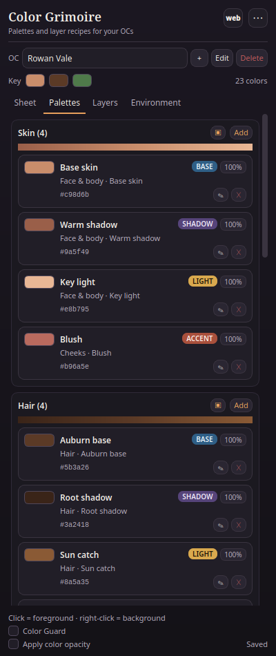
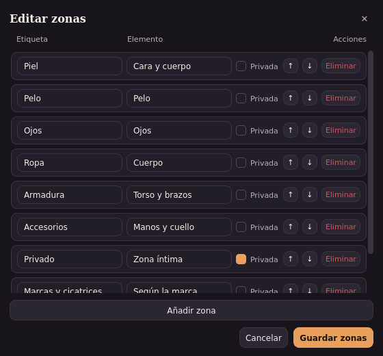
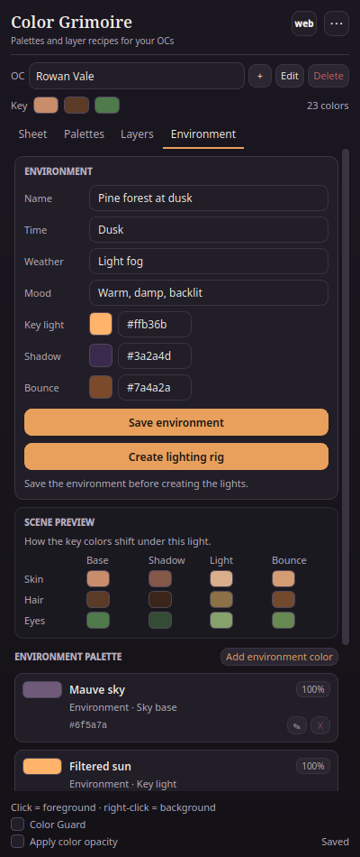

# [UPDATE] Color Grimoire 0.7.0 — flexible zones, a palette library and multiple lighting setups

Hi everyone,

I have just published **Color Grimoire 0.7.0**, an update to the free Krita docker I shared here.

Color Grimoire is a small art sheet inside Krita: it keeps the exact colors of a project, what each color is for, the layer recipe (Multiply, Add, Burn, etc.) and the lighting palette in one place. Click a swatch to set the foreground or background color, use Color Guard to check a color against the palette, and create the layer stack or a lighting rig in one action.

**Why 0.7.0?** I originally built it for my OCs. A few artists told me they were using it for scenery, props and color studies. That was the best feedback I could get: the tool should not force a character-shaped project. 0.7.0 makes the project fit the artwork, not the other way around.

## What's new

- **Characters, scenes and props.** When you create a project you choose a type. Each type starts with its own zones and layer recipe: 8 character zones (skin, hair, eyes...), 8 scene zones (sky, foliage, terrain, water, architecture, objects, FX, light) or 5 prop zones. You can add, rename, reorder, mark private or delete zones. Deleting a zone does not delete its colors: they stay as a hidden extra, so nothing disappears.
- **A palette library.** Save any zone as a reusable palette and import it into another project by copy. Useful for keeping a sky palette, a skin ramp or a prop material across several pieces.
- **Several lighting setups per project.** Day, sunset, night, fog... each project can hold as many environments as you need. The active one drives the scene preview, the lighting rig, the sheet and the print. The presets fill the fields; you can still edit everything.
- **A sheet that changes with the project.** Character projects show summary, history, personality and relationships. Scene and prop projects show the summary and the active environment, without empty personal fields. The labels read "Body part" for characters and "Element" for scenes and props.
- **A safer update.** If you used 0.4.1, your old `grimorio.json` is converted automatically on first load. The plugin writes `grimorio.json.v1.bak` before touching it. You do not need to export or rename anything.
- **Works alongside Loomis Head Guide 0.6.1.** If you use both, Grimoire keeps the `head` block as an opaque block: it does not interpret or change it. Update both plugins, save in Loomis first and then in Grimoire, and do not save in both at the same time.

## How it works in practice

1. Create a project and choose **Character**, **Scene** or **Prop**.
2. Add your colors: name, HEX, role, element or body part, purpose and opacity. Set the layer recipe and the environment (or several environments).
3. Paint. Left-click a swatch to set the foreground, right-click for the background. Color Guard shows the nearest palette color and lets you snap to it. **Create layers** builds the recipe in the active document; **Create lighting rig** builds the SHADOW, AO, LIGHT, GLOW and BOUNCE layers.
4. Save a zone to the **Library** when you want to reuse it, and export `.gpl` for Krita's Palette Docker or JSON for a backup.

## Updating from 0.4.1

Short version: close Krita, install the 0.7.0 ZIP, restart, open the docker. The first time it reads your old file it converts it and keeps the backup. Check one project and you are done. It takes about five minutes.

The full step-by-step guide, in English and Spanish, is here:
https://github.com/ImBoolean-2/color-grimoire/blob/main/MIGRATION-0.4.1-TO-0.7.0.md

If you use **Loomis Head Guide**, update both plugins. Save in Loomis first, then in Grimoire. The `head` block is preserved, and neither plugin needs the other to be installed.

**Please keep the `.v1.bak` file** until you have checked your projects. Downgrades are not supported; the backup is the safety net. Your photos and zone examples live in `images/` next to the JSON, so keep that folder with the JSON.

## Install (new users)

1. Download `grimorio_color-0.7.0.zip` from the release page.
2. Krita → **Tools → Scripts → Import Python Plugins**, select the ZIP.
3. Restart Krita.
4. **Settings → Configure Krita → Python Plugin Manager**: enable **Color Grimoire**.
5. Restart Krita again.
6. **Settings → Dockers → Color Grimoire**.

## Compatibility and notes

- Tested on **Krita 6.0.4.1** (Qt6) with the real plugin API. Krita 5.3.4.1 passes the model, bridge, translation and UI tests; the full real run is still pending when Krita is open and locks the resource database.
- Windows and macOS should work with the same ZIP, but I have not tested them yet. If you try, please report your Krita version and any error.
- The ZIP is the docker. The browser companion is a separate local app (not bundled); move data between them with Export/Import JSON.
- No network, no accounts, no telemetry. The private zone is hidden in the UI, not encrypted.

## Screenshots

## Feedback

I would love to hear how you use it: do the scene and prop presets cover your work, how do you use the library, should the lighting rig also paint masks or base colors, should Color Guard scan the whole layer instead of the current color, and is a native `.kpl` export the right next step? Bug reports with the Krita version and the Plugin Manager error are especially helpful.

**Download:** https://github.com/ImBoolean-2/color-grimoire/releases/tag/v0.7.0
**Full changelog:** https://github.com/ImBoolean-2/color-grimoire/blob/main/CHANGELOG.md
**License:** GPL-3.0-or-later

Thanks for trying it, and happy painting.
